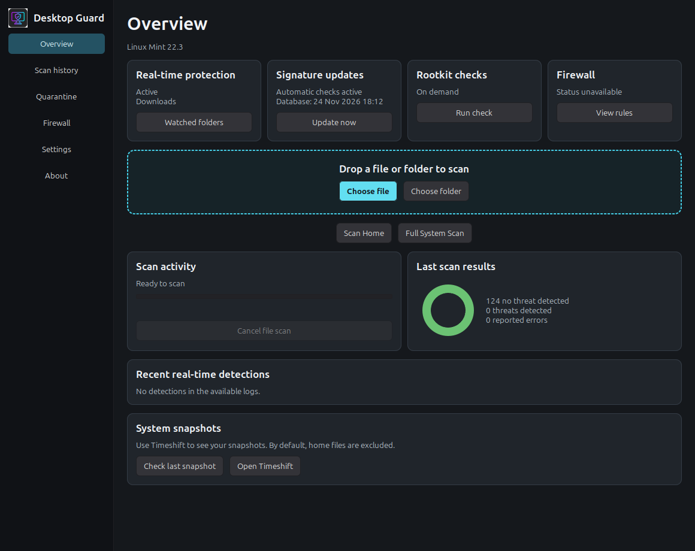

# Desktop Guard

I created Desktop Guard for people moving from Windows to Linux who miss having one place to see what their security tools are doing. When you’re new to Linux, an unfamiliar filename, an open connection, or a scanner warning can be hard to put in context. I wanted a simple way to see what’s running, what needs a closer look, and what I can do next.

Desktop Guard brings ClamAV scans and quarantine, Rootkit Hunter checks, UFW firewall rules and network activity, and Timeshift snapshot status into one Linux Mint dashboard. It uses the existing system tools and was developed with AI assistance.

This is an early preview. The dashboard, ClamAV file scanning, and quarantine workflow were tested on an existing Linux Mint 22.3 installation. Clean installation and the administrator workflows still need broader testing. A full scan can take a long time. The progress bar tracks completed stages and the timer shows how long the scan has been running.



## Install on Linux Mint 22.3

Open the Debian package in Mint’s package installer, or run the following from the folder containing the package.

```bash
sudo apt install ./desktop-guard_0.1.1_all.deb
```

Open Desktop Guard from the application menu. APT installs the required tools from your configured repositories. The package uses your existing system services and configuration. The Settings page shows the current ClamAV watched folders and exclusions. Choose **Watch my Home folder** to opt into the Home profile. It excludes the default cache, Trash, Steam library and quarantine paths and saves the original ClamAV configuration before applying changes.

## Scans and protection

- Drop local files or folders onto Overview, or use **Scan Home**.
- **Full System Scan** scans readable files on the root filesystem as your user, excluding virtual filesystems and other mounts. It then requests administrator authentication to run Rootkit Hunter. See Scan history for reported errors and warnings.
- Rootkit Hunter warnings can arise from legitimate changes. Review the detail before deciding whether action is needed. Desktop Guard never updates its file integrity baseline.
- **Update now** requests a ClamAV database check and separately requests an rkhunter database check when its system configuration permits downloads.
- Detection results offer manual quarantine for unchanged regular files you own on the same filesystem as the quarantine vault. Restore and permanent deletion require confirmation.
- **Firewall** reads live UFW status and rules after authentication. Use GUFW to make changes. Network activity can only name processes your account can inspect.
- Closing the window can keep Desktop Guard in the Cinnamon tray when a compatible tray is available. ClamAV and the firewall operate independently of the dashboard.

## Timeshift

Timeshift helps restore the Linux system after changes such as a broken update. By default, Timeshift excludes files in your home directory. Back up your documents, photos and other personal files separately. Use Timeshift to review its configured filters and snapshots.

## Build from source

Run `bash packaging/build.sh` to build the `.deb`. For an uninstalled preview, run `/usr/bin/python3 src/desktop-guard` with PyGObject, GTK 3 and GI Cairo installed. Administrative actions require the installed package.

Desktop Guard uses [ClamAV](https://www.clamav.net/), [Rootkit Hunter](https://rkhunter.sourceforge.net/), [UFW](https://launchpad.net/ufw), [GUFW](https://gufw.org/), and [Timeshift](https://github.com/linuxmint/timeshift). These projects are maintained separately.

## Licence

Desktop Guard is available under the [MIT licence](LICENSE). Its system dependencies retain their own licences.
